

  

  

  
  &nbsp;&nbsp;&nbsp;
  
  &nbsp;&nbsp;&nbsp;
  
  &nbsp;&nbsp;&nbsp;
  


<h3 align="center">
  
  Sobre Mim
</h3>

Sou o Lucas, formado em Técnico em Informática e Logística pelo Colégio Técnico Bento Quirino, cursando Engenharia de Software na PUC-Campinas. Desenvolvo projetos web e mobile com JavaScript, TypeScript, Python, C, HTML, CSS, Dart e Flutter.

<h3 align="center">
  
  Formação
</h3>

  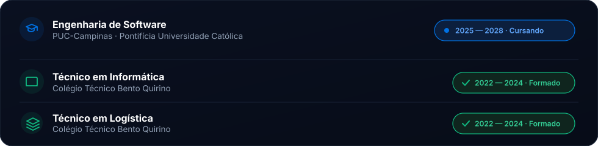

<h3 align="center">
  
  Stack Tecnológica
</h3>

<b>Linguagens</b>

  

<b>Frameworks &amp; Bibliotecas</b>

  

<b>Banco de Dados &amp; Backend</b>

  

<b>Ferramentas</b>

  

<h3 align="center">
  
  Projetos em Destaque
</h3>

  <a href="https://imoveislucasxavier.com.br/" target="_blank">
    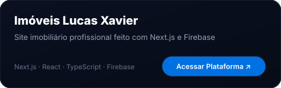
  </a>
  &nbsp;
  <a href="https://github.com/lucaxaviers/ES-PI3-2026-T1-G25" target="_blank">
    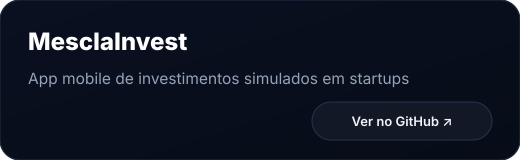
  </a>

  <a href="https://github.com/lucaxaviers/PI_II_ES_TIME_11" target="_blank">
    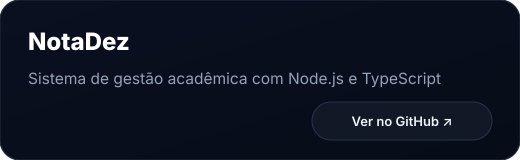
  </a>
  &nbsp;
  <a href="https://lucaxaviers.github.io/" target="_blank">
    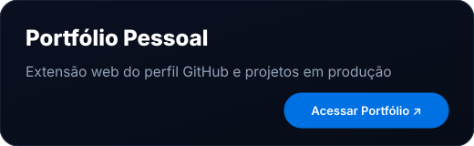
  </a>

  Veja todos os projetos na aba <a href="https://github.com/lucaxaviers?tab=repositories">Repositórios</a>.

<h3 align="center">
  
  Semestres da Faculdade
</h3>

  <a href="https://github.com/lucaxaviers/Primeiro-Semestre-ENG-de-Software">
    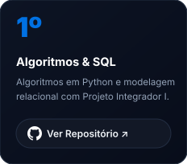
  </a>
  &nbsp;
  <a href="https://github.com/lucaxaviers/Segundo-Semestre-ENG-de-Software">
    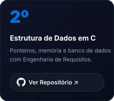
  </a>
  &nbsp;
  <a href="https://github.com/lucaxaviers/Terceiro-Semestre-ENG-de-Software">
    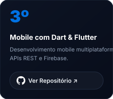
  </a>
  &nbsp;
  <a href="https://github.com/lucaxaviers/Quarto-Semestre-ENG-de-Software">
    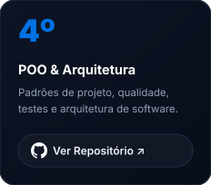
  </a>

<h3 align="center">
  
  Certificações
</h3>

  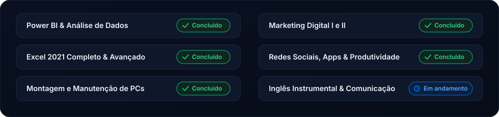

<h3 align="center">
  
  GitHub Stats
</h3>

  
  

<h3 align="center">
  
  Contribuições
</h3>

  <picture>
    <source media="(prefers-color-scheme: dark)" srcset="https://raw.githubusercontent.com/lucaxaviers/lucaxaviers/output/github-contribution-grid-snake-dark.svg">
    <source media="(prefers-color-scheme: light)" srcset="https://raw.githubusercontent.com/lucaxaviers/lucaxaviers/output/github-contribution-grid-snake.svg">
    
  </picture>

  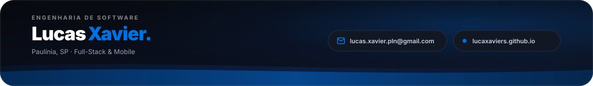

